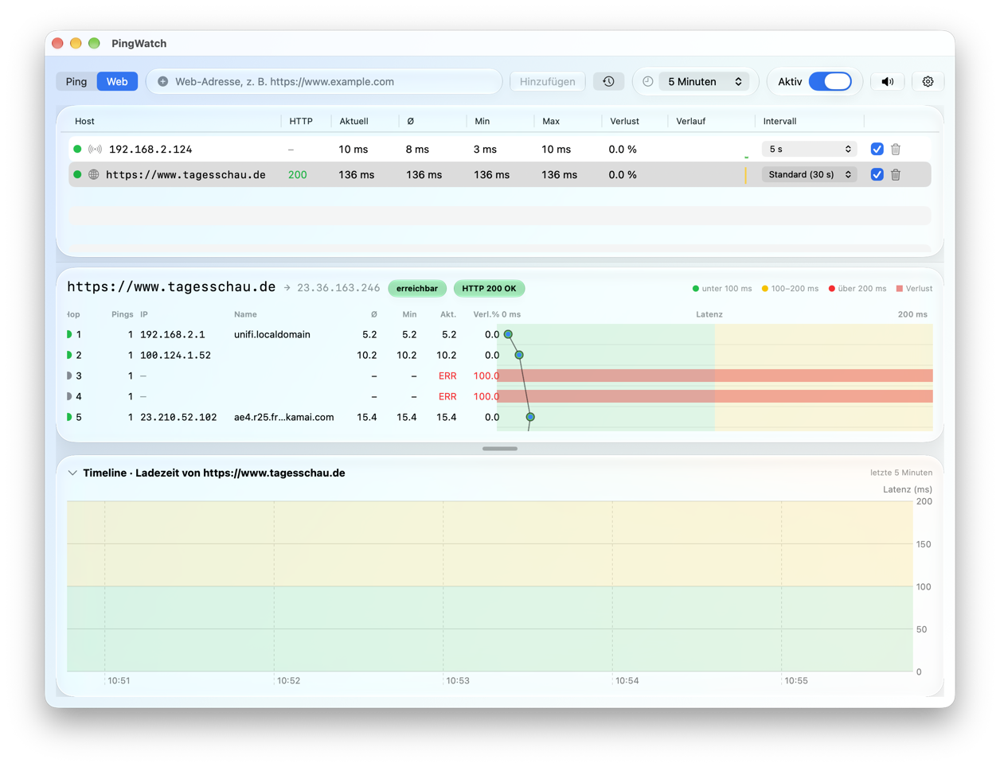
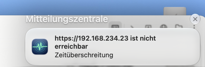

# PingWatch

**English** · [Deutsch](README.de.md)

A native Mac app that watches hosts and websites and lets you know when something changes: with a sound, a system banner and a [PingPlotter](https://www.pingplotter.com)-style interface showing the route, a latency graph and a timeline.

Written in Swift and SwiftUI, with no third-party libraries. The interface uses Liquid Glass from macOS 26.

<p align="center">
  
</p>
<p align="center"><sub>The screenshot shows the German interface. The app follows your macOS language.</sub></p>

## Features

**Monitor**
- **Ping:** IP addresses and hostnames (IPv4 and IPv6) are checked with `ping`.
- **Web:** A page is loaded over HTTP or HTTPS. A 2xx status counts as OK. The app shows the status code and the load time.
- **Choose the type of check when you add a host:** Ping or Web. For Web, `example.com` is enough and becomes `https://example.com`. For Ping, `https://www.example.com/page` is reduced to the host `www.example.com`.
- **Interval per host:** Default values for Ping (5 s) and Web (30 s) in the settings, plus a separate value for each host in the table.
- **Input history:** The last 50 hosts and web addresses are saved and suggested as you type.

**Notify**
- **Sound:** When a host becomes reachable the app plays PING, when it becomes unreachable it plays DOWN. Each can be repeated 1 to 20 times and uses any system sound you pick. Choosing a sound plays it once.
- **Failed checks before DOWN:** A host only counts as unreachable after a configurable number of failed checks in a row (default 2), so a single lost ping does not raise an alarm.
- **System banners:** When a host is reachable again, when it is unreachable, and for web hosts also when the HTTP status changes, for example 200 → 503.
- **Mute button** (⇧⌘M): silences the alarm sounds. Banners stay on.

<p align="center">
  
</p>

**Analyze**
- **Host table** with current, average, minimum and maximum response time, loss in percent, HTTP status and a small history graph.
- **Trace graph:** For the selected host the route is determined with traceroute. Each row is a router with IP, name, average, min, current and loss. Next to it a graph per row shows the min–max range, the loss and the average. A line joins the averages of the hops, so you can see which hop adds how much latency.
- **Timeline:** Latency of the selected hop or of the target over time. Lost pings appear as red lines. The height can be adjusted, or the timeline hidden.
- **Time range:** 5 minutes, 15 minutes, 1 hour or everything.
- **Colour zones** like PingPlotter: green up to 100 ms, yellow up to 200 ms, red above.

**Language**
- The app is available in **English and German** and follows the system language. Any other language shows English. To use a different language for PingWatch only, go to *System Settings → General → Language & Region → Applications*.

Hosts, settings, the selection and the input history are kept across restarts. The measurements themselves are not saved.

## Download and installation

Download the ready-made app from the [Releases page](https://github.com/abrocker/pingwatch/releases/latest) as a ZIP file (`PingWatch-1.1.0.zip`). It runs on Apple Silicon and Intel Macs with **macOS 26 or later**.

1. Download the ZIP file and double-click it to unpack it. Then drag `PingWatch.app` into the **Applications** folder.
2. Start `PingWatch` with a double-click. The first time, macOS shows a warning that the app cannot be opened because the developer could not be verified. That is expected (see below). Close the message.
3. Open **System Settings → Privacy & Security**, scroll down to the message about PingWatch and click **Open Anyway**. Confirm with your password or Touch ID. You only need to do this on the first start.
4. On first launch macOS asks whether PingWatch may send notifications. Allow it if you want system banners.

Instead of steps 2 and 3 you can use the Terminal. This command removes the download mark, after which the app starts normally:

```bash
xattr -dr com.apple.quarantine /Applications/PingWatch.app
```

**Why the warning?** The app is only signed ad hoc, not signed with an Apple Developer ID and notarized. That would need a paid Apple developer account. If you do not trust the file, compare the checksum (`shasum -a 256 PingWatch-1.1.0.zip`) with the one on the Releases page, or build the app from source.

## Build from source

Requirements:

- macOS 26 or later
- Xcode with a Swift toolchain (developed and tested with Xcode 27.1, Swift 6.4)

```bash
./build_app.sh
open build/PingWatch.app
```

The script builds the app in release mode, creates the app bundle with icon in `build/PingWatch.app` and signs it ad hoc. On first launch macOS asks whether PingWatch may send notifications. Without permission the app keeps working, only the banners are missing, and the settings show a note.

Run the tests with:

```bash
swift test
```

## Usage

1. Choose **Ping** or **Web** at the top, enter an address and confirm with Enter or **Add**. You can enter several addresses separated by spaces or commas.
2. Click a host in the table: below it you see the route and the timeline.
3. Click a hop in the route to see its timeline. The "Round Trip" row is the target itself, for web hosts the HTTP load time.
4. The gear opens the settings: default intervals, sounds, repeats, failed checks before DOWN and system banners.

## How it works

- **Ping** runs `/sbin/ping` (`ping6` for IPv6) with a timeout of two seconds.
- **Web** loads the page with `URLSession` (GET, redirects are followed, timeout 10 s). Every check opens a new connection, so DNS and TLS time are part of the load time. Only the HTML is loaded, not images or scripts.
- **Route** uses `/usr/sbin/traceroute`. The hop range is split into small parts that run at the same time, so a measurement usually takes one to three seconds instead of up to 20. It is only measured for the host that is currently selected. Routers that do not answer traceroute appear as "no response". That is normal and does not mean your connection is broken.
- **Interface** updates at most four times a second, even when many hosts are measured at once. Charts draw at most about 400 points, and the small history graphs in the table are a plain Canvas drawing.

## Project structure

```
Package.swift
build_app.sh            builds build/PingWatch.app
Resources/              Info.plist, AppIcon.icns, en.lproj and de.lproj (texts)
tools/make_icon.swift   creates the app icon
tools/make_release.sh   builds the release ZIP
Sources/
  PingCore/             logic without UI: ping, traceroute, web check,
                        state changes, statistics, history (with unit tests)
  PingWatch/            SwiftUI app: interface, monitor, sounds, banners
Tests/PingCoreTests/    unit tests for PingCore
```

## Notes

- The app runs **without the App Sandbox** because it starts `ping` and `traceroute` as programs.
- For web checks over `http://` the Info.plist allows unencrypted connections (`NSAllowsArbitraryLoads`).
- Do not poll other people's websites every second. That is why the default for Web is 30 seconds.
- Saved data lives in the user defaults under `local.pingwatch.app`. To reset it:

  ```bash
  defaults delete local.pingwatch.app
  ```

## For developers

- **Translations:** The texts live in `Resources/en.lproj` and `Resources/de.lproj` (`Localizable.strings`). The German texts in the code are the keys. To add a language, create a folder `<language>.lproj` with the same keys and add the language to `CFBundleLocalizations` in `Info.plist`.

- **Build the release ZIP:** The script builds the app for Apple Silicon and Intel, signs it ad hoc and packs it into `dist/PingWatch-<version>.zip`. The version number is in `Resources/Info.plist`. At the end it prints the checksum.

  ```bash
  ./tools/make_release.sh
  ```

- **Regenerate the icon:**

  ```bash
  swift tools/make_icon.swift Resources/AppIcon.iconset
  iconutil -c icns Resources/AppIcon.iconset -o Resources/AppIcon.icns
  ```

- **Load test:** With the environment variable `PINGWATCH_PREFILL=3600` the app starts with simulated measurements (one hour of history per host and ten hops per route). This lets you check the interface under load:

  ```bash
  open --env PINGWATCH_PREFILL=3600 build/PingWatch.app
  ```

- A test of the web check starts a local web server with `python3` and is skipped if `python3` is missing.

## License

Apache License 2.0, see [LICENSE](LICENSE).
